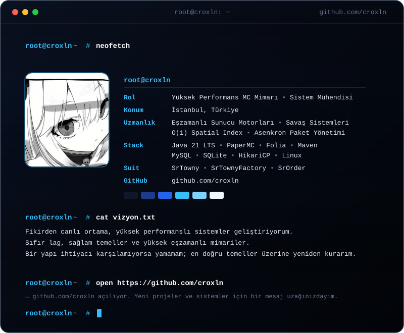
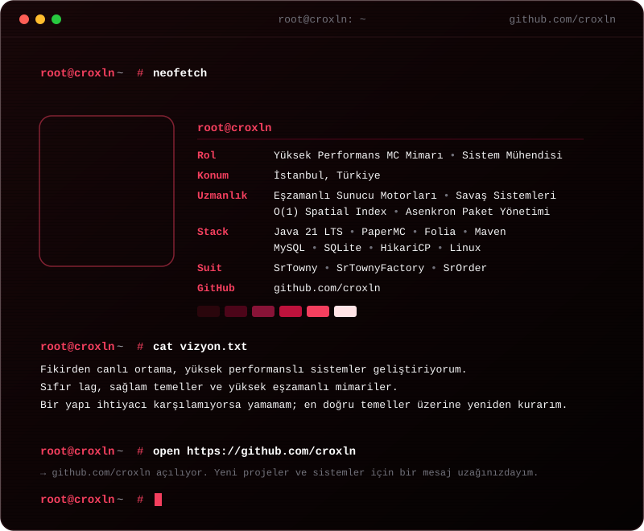

# 🎨 GitHub Profil Önizleme (Preview)

Bu dosya, orijinal `README.md` dosyanıza dokunulmadan önizleme yapabilmeniz için oluşturuldu. Beğendiğiniz temayı doğrudan ana `README.md` içerisine taşıyabilirsiniz.

---

## 🔵 1. Mavi Tema (Electric / Cyber Cyan)

  <!-- Mavi Terminal Kartı -->
  

    

  <!-- Mavi Temalı Butonlar -->
  
  &nbsp;
  
  &nbsp;
  

  

---

## 🔴 2. Kırmızı Tema (Cyber Crimson / Red)

  <!-- Kırmızı Terminal Kartı -->
  

    

  <!-- Kırmızı Temalı Butonlar -->
  
  &nbsp;
  
  &nbsp;
  

