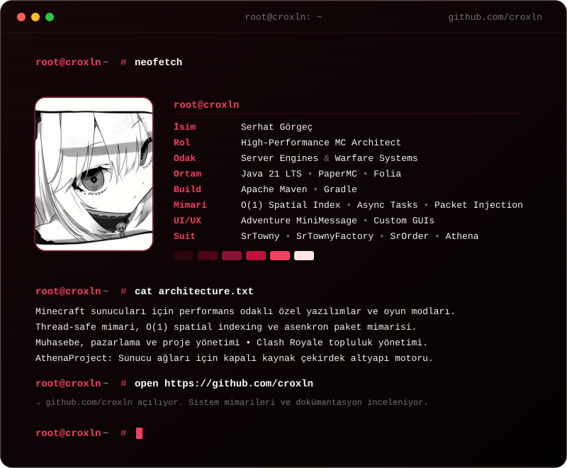

  <!-- Siber Kızıl / Crimson Terminal Kartı -->
  

    

  <!-- Tıklanabilir Butonlar -->
  
  &nbsp;
  
  &nbsp;
  

 

  <!-- Teknoloji Kartı / Technology Stack (Custom Dark Crimson Card) -->
  

 

### 📊 Real-Time GitHub Analytics

  
  

 

---

### 🏛️ SrProjects Architectural Suite (Showcase)

> [!NOTE]
> All core engines listed below are proprietary, enterprise-grade systems built for high-concurrency Minecraft networks. Repositories serve as public architectural documentation, changelogs, and issue trackers.

| Project | Description | Architecture Highlights | Status |
| :--- | :--- | :--- | :---: |
| **[SrTownyFactory](https://github.com/croxln/SrTownyFactory)** | Open-world strategic resource factories & industrial automation | Rise of Kingdoms border adjacency, 30-min KotH sieges, 16 industrial branches, Squaremap live rendering | `🟢 Active` |
| **[SrTowny](https://github.com/croxln/SrTowny)** | Core Towny & SiegeWar server architecture engine | Thread-safe nation warfare, custom tax cycles, dynamic town limits, modernization hooks | `🟢 Active` |
| **[SrOrder](https://github.com/croxln/SrOrder)** | Enterprise-grade player order & market exchange platform | Multi-economy compatibility, async escrow transactions, HikariCP indexed data stores | `🟢 Active` |
| **SrGunlukOdul** | Streak & seasonal progression daily rewards | Time-zone normalized cooldown calculations, anti-exploit IP/UUID verification | `🟢 Production` |
| **SrKillEffects** | Cosmetic elimination particles, sounds & animations | Non-blocking async packet dispatch, visual theme customization | `🟢 Production` |
| **SrUnlimitedNametags** | Async high-tick scoreboard & nametag teams | Zero-flicker team packet injection, async packet compliance | `🟢 Production` |
| **SrRTP** | Biome-optimized async random teleportation | Async chunk pre-loading, liquid/danger safety filtering, zero main-thread lag | `🟢 Production` |

 

---

Engineered with precision by <b>Serhat Görgeç (croxln)</b> • Closed-Source Core Suite • Powered by Java 21 LTS

