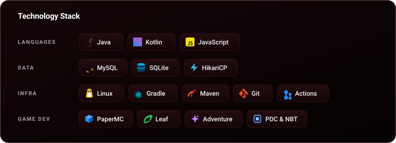

  <!-- Siber Kızıl / Crimson Terminal Kartı -->
  

   

  <!-- Profil Görüntülenme (Kırmızı) -->
  

   

  <!-- Tıklanabilir Butonlar -->
  
  &nbsp;
  
  &nbsp;
  

 

  <!-- Teknoloji Kartı / Technology Stack (Custom Dark Crimson Card) -->
  

 

  
  

 

---

### 🛡️ SrProjects Architectural Suite (Showcase)

> [!NOTE]
> Aşağıda listelenen projeler; Minecraft sunucuları için özel olarak geliştirilmiş oyun modları, sistem mimarileri ve altyapı motorlarıdır.

| Project | Description | Architecture Highlights | Status |
| :--- | :--- | :--- | :---: |
| **[SrTownyFactory](https://github.com/croxln/SrTownyFactory)** | Açık dünya stratejik kaynak fabrikaları & sanayi otomasyonu | Sınır bağlantılı bölge kontrolü, 30 dk KotH kuşatmaları, 16 sanayi dalı, canlı Squaremap haritası | `🟢 Active` |
| **[SrTowny](https://github.com/croxln/SrTowny)** | Özel Towny & SiegeWar sunucu mimari motoru | Thread-safe ulus savaşları, dinamik vergi döngüleri, optimize kasaba sınırları | `🟢 Active` |
| **[SrOrder](https://github.com/croxln/SrOrder)** | Gelişmiş oyuncu sipariş, takas ve açık artırma borsa platformu | Çoklu ekonomi desteği, asenkron emanet (escrow) işlemleri, HikariCP veri tabanı | `🟢 Active` |
| **SrGunlukOdul** | Seri ve sezonluk ilerlemeli günlük ödül sistemi | Saat dilimi normalize bekleme süreleri, anti-exploit IP/UUID doğrulaması | `🟢 Production` |
| **SrKillEffects** | Kozmetik eliminasyon efektleri, sesler ve animasyonlar | Ana kanalı kasmayan asenkron paket dağıtımı, görsel tema özelleştirme | `🟢 Production` |
| **SrUnlimitedNametags** | Yüksek tick oranlı scoreboard & nametag takımları | Titremesiz paket enjeksiyonu, Folia ve çoklu bölge uyumluluğu | `🟢 Production` |
| **SrRTP** | Biyom odaklı asenkron rastgele ışınlanma | Asenkron chunk ön yükleme, sıvı/tehlike güvenlik filtreleri, sıfır lag | `🟢 Production` |
| **AthenaProject** | Sunucu ağları için özel çekirdek ve altyapı motoru | Asenkron mekanikler, optimize veri yönetimi, modüler mimari | `🔒 Private Core` |

 

---

Engineered with precision by <b>Serhat Görgeç (croxln)</b> • Closed-Source Core Suite • Powered by Java 21 LTS

